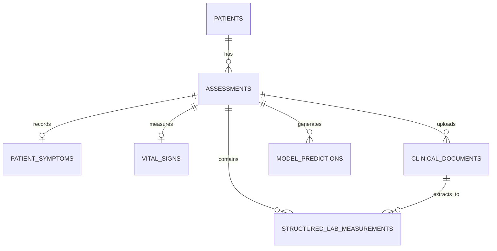

# Relational Database Schema and Persistence Architecture

## 1. Overview and Design Principles

The clinical persistence layer is built on **SQLAlchemy** and **Flask-Migrate (Alembic)**, integrated with `backend/extensions.py` and `backend/config.py`.



### Core Clinical & Regulatory Directives

1. **HIPAA De-Identification & Privacy Controls**:
   - The database does NOT store plaintext patient full names, social security numbers, or raw institutional medical record numbers (MRNs).
   - Patients are identified by a unique `patient_code` (e.g. `DEMO-PT-CAD-001`). External hospital MRNs are stored exclusively as one-way SHA-256 cryptographic hashes (`medical_record_number_hash`).
2. **Strict Distinction Between Missing Values and Zero**:
   - In clinical physiological data, an unmeasured parameter must NEVER be conflated with a numerical zero ($0.0$).
   - For example, a missing systolic blood pressure must be stored as `NULL`, whereas a blood pressure of `0 mm Hg` indicates cardiac arrest. All vital sign and laboratory numeric columns are strictly `nullable=True` with no default values.
3. **Separation of Uploaded Files from Structured Measurements**:
   - Uploaded documents (PDFs, images) are stored in `clinical_documents` as raw binary asset metadata (file path, MIME type, SHA-256 hash, and parsing status).
   - An uploaded document is **never** automatically treated as verified clinical measurements. Structured data are stored exclusively in `structured_lab_measurements` with explicit clinician verification flags.
4. **Retrospective Model Auditability**:
   - Every row in `model_predictions` captures the exact `model_name`, `model_version`, full `target_definition` text, raw score, calibrated probability flag, and complete JSON snapshots of input features and explainability attributions.

---

## 2. Entity Schema Details

### 1. `patients`
| Column | Type | Constraints | Description |
| :--- | :--- | :--- | :--- |
| `id` | Integer | PK, Autoincrement | Internal surrogate key. |
| `patient_code` | VARCHAR(36) | Unique, Indexed, NOT NULL | De-identified patient identifier. |
| `age` | Integer | NOT NULL | Patient age in years. |
| `sex` | VARCHAR(10) | NOT NULL | Biological sex ('Male', 'Female'). |
| `medical_record_number_hash` | VARCHAR(64) | Indexed, Nullable | SHA-256 hash of external medical record number. |
| `notes` | Text | Nullable | De-identified administrative notes. |
| `is_active` | Boolean | NOT NULL, Default=True | Soft-delete / active status flag. |
| `created_at` | DateTime(UTC) | NOT NULL | Record creation timestamp. |
| `updated_at` | DateTime(UTC) | NOT NULL | Record last updated timestamp. |

### 2. `assessments`
| Column | Type | Constraints | Description |
| :--- | :--- | :--- | :--- |
| `id` | Integer | PK, Autoincrement | Internal encounter ID. |
| `patient_id` | Integer | FK(`patients.id`, CASCADE), NOT NULL, Indexed | Linked patient record. |
| `assessment_date` | DateTime(UTC) | NOT NULL, Indexed | Date and time of clinical encounter. |
| `status` | VARCHAR(30) | NOT NULL, Default='completed' | Encounter status (`in_progress`, `completed`, `flagged_emergency`). |
| `reason_for_visit` | VARCHAR(255) | Nullable | Primary patient complaint or visit indication. |
| `clinical_notes` | Text | Nullable | Attending clinician notes and observations. |
| `emergency_escalation_level` | VARCHAR(50) | Nullable | Emergency triage status (`EMERGENCY_IMMEDIATE_911`, `NONE`). |
| `created_at` | DateTime(UTC) | NOT NULL | Timestamp when record was saved. |

### 3. `patient_symptoms`
| Column | Type | Constraints | Description |
| :--- | :--- | :--- | :--- |
| `id` | Integer | PK, Autoincrement | Symptom record ID. |
| `assessment_id` | Integer | FK(`assessments.id`, CASCADE), Unique, NOT NULL, Indexed | 1:1 relationship with assessment. |
| `chest_pain` | Boolean | Nullable | Presence of chest discomfort (Null = unasked). |
| `chest_pain_quality` | VARCHAR(50) | Nullable | Quality ('crushing', 'pressure', 'sharp', etc.). |
| `chest_pain_radiation` | VARCHAR(100) | Nullable | Radiation sites ('left arm', 'jaw', 'back'). |
| `substernal_location` | Boolean | Nullable | Retrosternal / substernal chest position. |
| `exertional_provocation` | Boolean | Nullable | Provoked by physical exertion. |
| `relieved_by_rest` | Boolean | Nullable | Relieved within minutes by rest or nitroglycerin. |
| `dyspnea` | Boolean | Nullable | Shortness of breath reported by patient. |
| `orthopnea` | Boolean | Nullable | Breathlessness when lying recumbent. |
| `paroxysmal_nocturnal_dyspnea` | Boolean | Nullable | Waking breathless during the night. |
| `palpitations` | Boolean | Nullable | Sensation of rapid or irregular heartbeats. |
| `syncope` | Boolean | Nullable | History of fainting / loss of consciousness. |
| `diaphoresis` | Boolean | Nullable | Cold sweats or unexplained sweating. |
| `bilateral_leg_edema` | Boolean | Nullable | Lower extremity peripheral swelling. |
| `angina_classification` | VARCHAR(30) | Nullable | Diamond-Forrester category (`typical`, `atypical`, `none`). |
| `congestive_score` | Integer | Nullable | Number of congestive heart failure signs met. |
| `reported_at` | DateTime(UTC) | NOT NULL | Timestamp of symptom reporting. |

### 4. `vital_signs`
| Column | Type | Constraints | Description |
| :--- | :--- | :--- | :--- |
| `id` | Integer | PK, Autoincrement | Vital sign record ID. |
| `assessment_id` | Integer | FK(`assessments.id`, CASCADE), Unique, NOT NULL, Indexed | 1:1 relationship with assessment. |
| `systolic_bp` | Float | Nullable (NO default) | Systolic blood pressure in mm Hg. |
| `diastolic_bp` | Float | Nullable (NO default) | Diastolic blood pressure in mm Hg. |
| `heart_rate` | Float | Nullable (NO default) | Resting heart rate in beats per minute. |
| `respiratory_rate` | Float | Nullable (NO default) | Respiratory rate in breaths per minute. |
| `spo2` | Float | Nullable (NO default) | Pulse oximetry oxygen saturation percentage. |
| `temperature_celsius` | Float | Nullable (NO default) | Body temperature in °C. |
| `height_cm` | Float | Nullable (NO default) | Height in centimeters. |
| `weight_kg` | Float | Nullable (NO default) | Weight in kilograms. |
| `bmi` | Float | Nullable (NO default) | Calculated Body Mass Index (kg/m²). |
| `measured_at` | DateTime(UTC) | NOT NULL | Measurement acquisition timestamp. |

### 5. `clinical_documents`
| Column | Type | Constraints | Description |
| :--- | :--- | :--- | :--- |
| `id` | Integer | PK, Autoincrement | Document asset ID. |
| `assessment_id` | Integer | FK(`assessments.id`, CASCADE), NOT NULL, Indexed | Encounter where file was uploaded. |
| `original_filename` | VARCHAR(255) | NOT NULL | Filename supplied during upload. |
| `stored_filename` | VARCHAR(255) | Unique, NOT NULL | Safe randomized storage filename. |
| `file_type` | VARCHAR(20) | NOT NULL | Type category (`pdf`, `image_png`, `image_jpeg`). |
| `mime_type` | VARCHAR(100) | NOT NULL | Verified MIME content type. |
| `file_size_bytes` | Integer | NOT NULL | File size on disk in bytes. |
| `sha256_hash` | VARCHAR(64) | NOT NULL, Indexed | SHA-256 cryptographic digest for deduplication. |
| `document_category` | VARCHAR(50) | NOT NULL | Category (`ecg_report_pdf`, `lab_results`). |
| `parsing_status` | VARCHAR(30) | NOT NULL, Default='stored_unparsed' | Parsing workflow state. |
| `is_verified_by_clinician` | Boolean | NOT NULL, Default=False | Clinician verification flag. |
| `uploaded_at` | DateTime(UTC) | NOT NULL | Upload timestamp. |

### 6. `structured_lab_measurements`
| Column | Type | Constraints | Description |
| :--- | :--- | :--- | :--- |
| `id` | Integer | PK, Autoincrement | Lab measurement ID. |
| `assessment_id` | Integer | FK(`assessments.id`, CASCADE), NOT NULL, Indexed | Encounter ID. |
| `document_id` | Integer | FK(`clinical_documents.id`, SET NULL), Nullable, Indexed | Optional link to source document. |
| `test_name` | VARCHAR(100) | NOT NULL, Indexed | Standardized test code (`cholesterol`, `troponin_i`, etc.). |
| `value_numeric` | Float | Nullable | Quantitative numerical test value. |
| `value_text` | VARCHAR(100) | Nullable | Qualitative result text (`<0.01`, `normal`). |
| `unit` | VARCHAR(30) | Nullable | Measurement unit (`mg/dL`, `pg/mL`, `%`). |
| `reference_low` | Float | Nullable | Lower biological reference limit. |
| `reference_high` | Float | Nullable | Upper biological reference limit. |
| `flag` | VARCHAR(20) | Nullable | Clinical alert flag (`normal`, `high`, `critical_high`). |
| `recorded_at` | DateTime(UTC) | NOT NULL | Timestamp of laboratory result recording. |

### 7. `model_predictions`
| Column | Type | Constraints | Description |
| :--- | :--- | :--- | :--- |
| `id` | Integer | PK, Autoincrement | Prediction record ID. |
| `assessment_id` | Integer | FK(`assessments.id`, CASCADE), NOT NULL, Indexed | Associated clinical encounter. |
| `task_name` | VARCHAR(60) | NOT NULL, Indexed | Canonical task (`coronary_artery_disease`, etc.). |
| `model_name` | VARCHAR(120) | NOT NULL | Exact model architecture title. |
| `model_version` | VARCHAR(30) | NOT NULL | Semantic version of serialized artifact. |
| `target_definition` | Text | NOT NULL | Exact medical meaning of training target. |
| `predicted_class_id` | Integer | Nullable | Discrete predicted class index. |
| `predicted_class_label` | VARCHAR(100) | NOT NULL | Human-readable prediction label. |
| `raw_score` | Float | Nullable | Raw model score or decision value. |
| `calibrated_probability` | Float | Nullable | Calibrated probability estimate (if calibrated). |
| `is_probability_calibrated` | Boolean | NOT NULL, Default=False | True if score is empirically calibrated. |
| `decision_threshold` | Float | Nullable | Binary classification cutoff (typically 0.5). |
| `score_type` | VARCHAR(50) | NOT NULL | Score interpretation string. |
| `input_features_snapshot` | JSON | Nullable | Complete JSON record of inputs fed into model. |
| `explanation_snapshot` | JSON | Nullable | SHAP values or feature attributions. |
| `clinical_prototype_disclaimer` | Text | NOT NULL | Mandatory non-diagnostic research disclaimer. |
| `created_at` | DateTime(UTC) | NOT NULL | Prediction generation timestamp. |

---

## 3. Database Migration and Seeding Commands

### Apply Pending Migrations
```powershell
python -m flask --app "backend.app:create_app" db upgrade --directory database/migrations
```

### Generate a New Migration
When making future changes to `database/models.py`:
```powershell
$env:FLASK_MIGRATING = "1"
python -m flask --app "backend.app:create_app" db migrate --directory database/migrations -m "describe_changes_here"
```

### Seed Synthetic Demo Cohort
```powershell
python database/seed_demo_data.py
```

### Verify Migration History
```powershell
python -m flask --app "backend.app:create_app" db history --directory database/migrations
```
