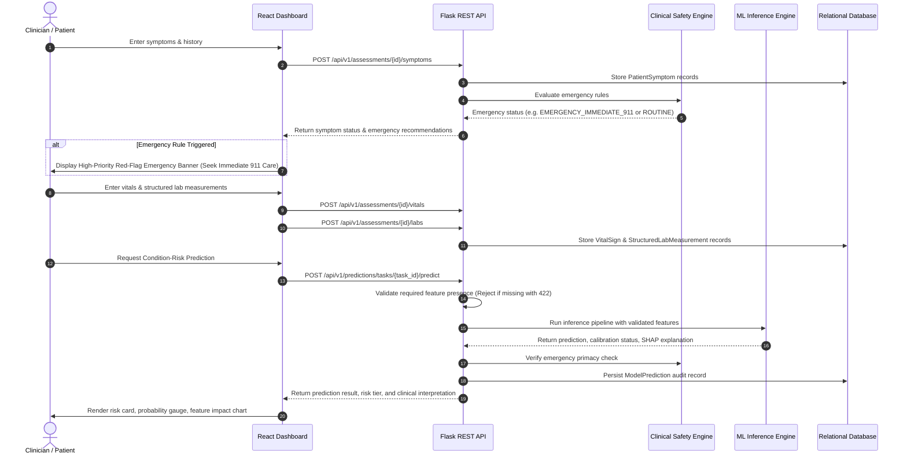

# System Architecture

**Project**: Heart Disease Screening and Condition-Risk Prediction System  
**Document**: End-to-End System Architecture & Component Interaction Specification  
**Classification**: Research & Educational Clinical Decision-Support Prototype  
**Date**: October 2026  

---

## 1. Architectural Philosophy & Safety-First Mandates

The **Heart Disease Screening and Condition-Risk Prediction System** is an integrated full-stack clinical decision-support and risk stratification platform. The architecture is engineered around the principle of **clinical safety primacy**:

1. **Independent Clinical Safety Triage**: Emergency rule evaluation executes independently of and takes precedence over machine learning models. A low statistical model score cannot reassure a patient who exhibits red-flag emergency symptoms or critical vital signs.
2. **Explicit Feature Contracts (Zero Silent Imputation)**: The system rejects incomplete clinical feature sets with explicit HTTP 422 errors instead of silently substituting mean or zero values.
3. **Task-Specific ML Scopes**: Machine learning models are strictly bound to their clinically validated target definitions and cohorts. Inapplicable tasks (such as general heart failure screening from outpatient symptoms) are rejected by design.
4. **Data Isolation & De-identification**: Plaintext medical record numbers (MRNs) are never stored in persistence. External identifiers are cryptographically hashed, and internal records use pseudorandom patient codes.
5. **Secure Unparsed Document Storage**: Uploaded diagnostic reports and ECG PDFs are validated with magic-byte inspection, stored outside public web roots with randomized UUIDs, and marked as `stored_unparsed` unless a clinician validates extracted structured values.

---

## 2. High-Level Architecture Diagram

```
+-----------------------------------------------------------------------------------+
|                                React 19 + Vite Frontend                           |
|  - Modern Dark-Themed UI (Lucide Icons, Glassmorphic Panels, Responsive Grid)     |
|  - Patient Intake -> Symptom Triage -> Vitals/Labs -> Task Routing -> Results     |
|  - Red-Flag Emergency Banner & Diagnostic Recommendations Display                 |
+-----------------------------------------------------------------------------------+
                                          |
                         HTTPS / JSON REST API (Port 5000)
                                          |
                                          v
+-----------------------------------------------------------------------------------+
|                             Flask Backend Application                             |
|  +-----------------------------------------------------------------------------+  |
|  | Middleware: CORS Origin Whitelist, JWT Auth & RBAC, Sensitive Data Logger   |  |
|  +-----------------------------------------------------------------------------+  |
|  | Blueprints:                                                                 |  |
|  |  - /api/v1/auth            : JWT Authentication, Session Profile            |  |
|  |  - /api/v1/patients        : De-identified Patient Profile CRUD             |  |
|  |  - /api/v1/assessments     : Symptom Intake, Vital Signs, Document Upload   |  |
|  |  - /api/v1/recommendations : Emergency Rules & Test Recommendations         |  |
|  |  - /api/v1/predictions     : Task Compatibility, ML Inference, Audit Store  |  |
|  |  - /api/v1/health          : Liveness, Readiness, Dependency Health Probes  |  |
|  +-----------------------------------------------------------------------------+  |
+-----------------------------------------------------------------------------------+
             |                                              |
             v                                              v
+-------------------------------+             +-------------------------------------+
|   Clinical Safety Engine      |             |       Machine Learning Engine       |
| - Emergency Triage (AHA/ACC)  |             | - Model Registry (joblib artifacts) |
| - Symptom Association Rules   |             | - Strict Feature Preprocessing      |
| - Secondary Test Recommender  |             | - Calibrated Inference (CAD / HF)   |
| - Primacy Enforcement         |             | - SHAP & Permutation Explainability |
+-------------------------------+             +-------------------------------------+
             |                                              |
             +----------------------+-----------------------+
                                    |
                                    v
+-----------------------------------------------------------------------------------+
|                        Relational Persistence Layer (SQLAlchemy)                  |
|  - SQLite (Development) / PostgreSQL (Production)                                 |
|  - Tables: patients, assessments, patient_symptoms, vital_signs,                   |
|            clinical_documents, structured_lab_measurements, model_predictions     |
|  - Sensitive Data Isolation: Private Storage Directory (/uploads)                 |
+-----------------------------------------------------------------------------------+
```

---

## 3. Subsystem Breakdown

### 3.1. Frontend Presentation Layer (`frontend/`)
- **Technology**: React 19, Vite 8, React Router v7, Vanilla CSS custom design system.
- **Responsibilities**:
  - Patient management, search, and selection.
  - Interactive multi-step clinical assessment wizard:
    - Step 1: Patient Profile & Demographics.
    - Step 2: Symptom Assessment with immediate red-flag detection.
    - Step 3: Clinical Safety Recommendations & Secondary Diagnostic Guidance.
    - Step 4: Vital Signs and Structured Laboratory Entry.
    - Step 5: Report Document Uploads (PDF/Images) with status tracking.
    - Step 6: Predictive Risk Stratification & Model Interpretation.
    - Step 7: Longitudinal Assessment History.
  - **Security Controls**: JWT storage in secure local memory/storage, automatic token transmission via Axios/fetch interceptor, client-side input validation, route guards enforcing clinician vs. patient views.

### 3.2. Backend Application & REST API (`backend/`)
- **Technology**: Python 3.10+, Flask 3.1+, SQLAlchemy 2.0+, Marshmallow schemas.
- **Responsibilities**:
  - Request validation and response contract serialization.
  - JWT generation, validation, and role-based access control (`clinician`, `admin`, `patient`).
  - Sensitive data filtering in logging to prevent credential leakage.
  - Centralized error formatting (consistent JSON format for 400, 401, 403, 404, 405, 413, 422, 500, 503).
  - CORS header restriction to authorized frontend development origins (`http://localhost:5173`, `http://127.0.0.1:5173`).

### 3.3. Deterministic Clinical Safety Engine (`clinical_rules/`)
- **Modules**:
  - `emergency_rules.py`: Evaluates red-flag symptoms (crushing chest pain, syncope, acute dyspnea, diaphoresis) and extreme vitals (hypertensive crisis, critical bradycardia/tachycardia, hypoxia). Categorizes urgency into `EMERGENCY_IMMEDIATE_911`, `URGENT_EVALUATION`, or `ROUTINE`.
  - `symptom_rules.py`: Maps patient symptoms to Diamond-Forrester chest pain categories (Typical Angina, Atypical Angina, Non-Anginal, Asymptomatic).
  - `test_recommendations.py`: Generates evidence-based diagnostic test recommendations (12-lead ECG, high-sensitivity Troponin, Echocardiography, BNP/NT-proBNP, Coronary CTA).
  - `coordinator.py`: Unified safety coordinator that guarantees emergency rule supremacy over ML outputs.

### 3.4. Machine Learning Inference Engine (`Machine_Learning/`)
- **Modules**:
  - `Machine_Learning/src/inference.py`: Centralized inference dispatcher.
  - `Machine_Learning/src/predict.py`: Core prediction runner.
  - `Machine_Learning/src/evaluate.py`: Empirical calibration diagnostics and performance metrics.
- **Model Registry**:
  - `cad_model.joblib`: Preprocessing pipeline and Support Vector Classifier (RBF) with Platt scaling for coronary artery disease.
  - `heart_failure_mortality_model.joblib`: Gradient Boosting model for follow-up mortality among diagnosed heart failure patients.
  - `arrhythmia_model.joblib`: Multiclass Random Forest for 12-lead ECG feature classifications.

### 3.5. Persistence Layer (`database/`)
- **ORM**: SQLAlchemy with declarative models.
- **Entities**:
  - `Patient`: De-identified demographic records, pseudorandom `patient_code`, hashed MRN (`medical_record_number_hash`).
  - `Assessment`: Clinical encounter header linking symptoms, vitals, documents, recommendations, and predictions.
  - `PatientSymptom`: Patient-reported symptoms, onset date, severity, and Diamond-Forrester classification.
  - `VitalSign`: Measured clinical vitals with nullable fields distinguishing genuine zero from unmeasured values.
  - `ClinicalDocument`: Metadata for uploaded medical documents, original filename, sanitized disk filename, MIME type, upload status (`stored_unparsed`).
  - `StructuredLabMeasurement`: Discrete laboratory measurements (cholesterol, glucose, troponin, creatinine).
  - `ModelPrediction`: Prediction audit trail capturing task name, model name, model version, raw score, calibrated probability, risk tier, target definition, and local SHAP feature attributions.

---

## 4. End-to-End Clinical Data Flow



---

## 5. Security Architecture & Threat Mitigations

| Threat Vector | Mitigation Strategy | Implementation Location |
| :--- | :--- | :--- |
| **MRN Disclosure & PII Leaks** | Plaintext MRNs are hashed using SHA-256 upon reception; internal patient codes (`PT-XXXX`) are pseudorandom. | [`database/models.py`](file:///c:/Users/lodha/Downloads/Heart_Disease_Screening/database/models.py) |
| **Credential & Token Leakage in Logs** | Logging filter redacts passwords, JWT tokens, and authorization headers from stdout and log files. | [`backend/app.py`](file:///c:/Users/lodha/Downloads/Heart_Disease_Screening/backend/app.py) |
| **Cross-Patient Data Access** | RBAC restricts `patient` role users to viewing exclusively their own record (`patient_id` claim check). | [`backend/utils/security.py`](file:///c:/Users/lodha/Downloads/Heart_Disease_Screening/backend/utils/security.py) |
| **Malicious File Uploads** | Allowed extensions whitelist (`.pdf`, `.png`, `.jpg`, `.jpeg`), magic byte inspection, UUID renaming, storage outside static web roots. | [`backend/routes/assessment_routes.py`](file:///c:/Users/lodha/Downloads/Heart_Disease_Screening/backend/routes/assessment_routes.py) |
| **Path Traversal Attacks** | File uploads sanitized with `werkzeug.utils.secure_filename` and stored with generated UUIDs. | [`backend/routes/assessment_routes.py`](file:///c:/Users/lodha/Downloads/Heart_Disease_Screening/backend/routes/assessment_routes.py) |
| **Silent Imputation Flaws** | ML pipelines require explicit feature validation; missing features return HTTP 422 with missing field names. | [`backend/services/prediction_service.py`](file:///c:/Users/lodha/Downloads/Heart_Disease_Screening/backend/services/prediction_service.py) |
| **False Reassurance via ML** | Emergency clinical rules execute independently and override low ML risk scores. | [`clinical_rules/coordinator.py`](file:///c:/Users/lodha/Downloads/Heart_Disease_Screening/clinical_rules/coordinator.py) |
